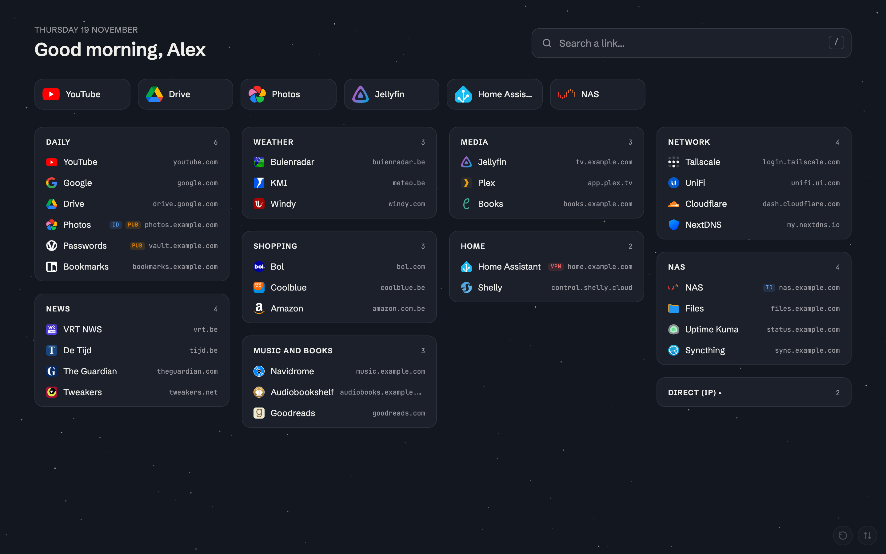
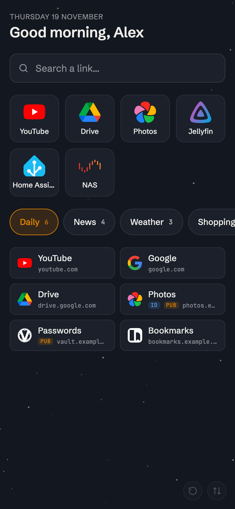

# Launchpad

A fast, dark start page with all your links in one place. No server, no database, no build step: three files and a folder of icons.





## Features

- **Search**: press `/` and start typing. `Enter` opens the first match, `Esc` clears.
- **Favourites** as big tiles at the top.
- **Blocks of links** in columns; on a phone they turn into tabs.
- **Labels** like `pub`, `id` or `vpn` next to a link, defined by you in `config.js`.
- **Sorting**: the button at the bottom right lets you drag links to another spot or block. Your browser remembers the order.
- **Collapsible blocks** for links you rarely need.
- A greeting that follows the time of day, the date, and a calm starry sky in the background.
- English or Dutch interface.

## Getting started

1. Click **Use this template** → **Create a new repository** (or grab the zip via **Code** → **Download ZIP**).
2. Edit `config.js`: your name, the language and your labels.
3. Edit the links in `index.html`. A link is one line:
   ```html
   <li><a href="https://example.com" data-icon="example.svg">Example</a></li>
   ```
   Put the icon in the `icons/` folder. Without an icon you get a neutral one.
4. Put it online, pick one:
   - **GitHub Pages**: in your repo go to **Settings** → **Pages**, choose the branch `main` and click **Save**. A minute later your page lives at `https://<your-name>.github.io/<repo>/`.
   - **Cloudflare Pages**: **Workers & Pages** → **Create** → **Pages** → connect your repo, leave the build command empty.
   - **Just locally**: open `index.html` in your browser and set it as your start page.

After changing `app.js` or `style.css`, bump the little `?v=` number in `index.html`, or your browser keeps showing the old version.

## Optional: sync the order across devices

By default every browser remembers its own order. To share it between all your devices, use Cloudflare:

1. Host the site on **Cloudflare Pages** (see above).
2. Create a **D1** database and bind it to the Pages project as `DB`.
3. Put the site behind **Cloudflare Access** (Zero Trust), so only you can reach it.
4. Set the environment variable `LAUNCHPAD_HOST` to your own host name (e.g. `start.example.com`).

The functions in `functions/api/` then store the order and count clicks. Without Access they refuse everything and the page falls back to your browser.

## Icons

App logos come from [dashboard-icons](https://github.com/homarr-labs/dashboard-icons) and [simple-icons](https://simpleicons.org). More in [icons/SOURCES.md](icons/SOURCES.md).

## About

Launchpad is the start page I use every day, cleaned up so anyone can take it. It's a showcase: take whatever you like, but don't expect support or new releases.

License: [MIT](LICENSE).
